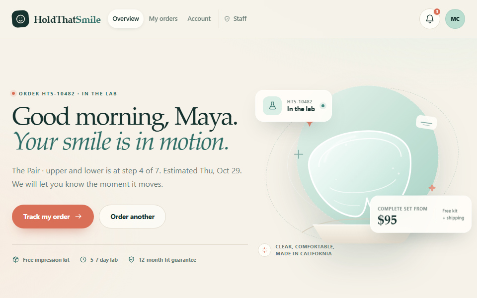

# HoldThatSmile

**A clear-retainer business in one app: customers order and track, the lab runs production, and payments reconcile.**

[Live demo](https://retainer-hub-022114524805790317561.vercel.app) | HTML, CSS and JavaScript, no build step



A customer app and a lab operations console for a direct-to-consumer clear-retainer company.
Customers order retainers, submit delivery details, follow their impression kit and manufacturing
progress, and keep a smile history. Staff sign in to a console and move orders through production.

## What it does

- **Overview.** A seeded customer dashboard with the active order, a kit and production tracker,
  updates and care guidance.
- **Orders.** Archive with live status, delivery estimates and one-click reorder.
- **Order journey.** Impression kit, lab stages, delivery, payment and support on one page.
- **A three-step order flow.** Choose a set, add delivery details, then demo payment and confirmation.
- **Account.** Profile, shipping address, lab notes, notification preferences and card on file.
- **Lab console.** Staff PIN gate, then orders, a production board, customers and a payment ledger.

## Run it locally

```bash
npm start
```

Open <http://127.0.0.1:4176>. The staff demo PIN is **2468**.

## Verify

```bash
npm run verify
```

That runs three checks:

- `scripts/verify.mjs` covers seed integrity, stage transitions, payment review, order creation,
  profile updates and admin metrics.
- `scripts/render-smoke.mjs` renders every customer route and the admin dashboard against a DOM stub.
- `scripts/smoke.mjs` serves the app and checks the entry route, CSS, JS modules and SPA fallback.

## Routes

| Route | What it does |
|---|---|
| `#/overview` | Customer dashboard: active order, tracker, updates, care guidance |
| `#/orders` | Order archive with status, delivery estimates and reorder |
| `#/orders/HTS-10482` | Full order journey: kit, lab stages, delivery, payment, support |
| `#/order` | Three-step order flow ending in demo payment and confirmation |
| `#/account` | Profile, address, lab notes, notifications, card on file |
| `#/admin` | Staff PIN gate, then orders, production board, customers, payments |

## How it is built

```
index.html          static entry, app mount
styles.css          design system and responsive layout
js/data.js          seed data and stage/product vocabulary
js/store.js         pure domain store: orders, stages, payments, profile, metrics
js/app.js           hash router, renderers, forms, admin console, localStorage persistence
dev-server.mjs      local static server (excluded from deployment)
scripts/            verification only
```

The store is the seam. It is pure and testable in Node, with no DOM or browser APIs, so each method
maps cleanly to an authenticated API call in production: `createOrder` to `POST /api/orders`,
`advanceOrder` to a staff-guarded stage change, `collectPayment` to a Stripe webhook, `updateProfile`
to `PATCH /api/me`, and `metrics` to a role-scoped aggregate query.

## What is simulated

The staff PIN and customer session are client-side demo state. Payments are simulated and card
numbers are validated for shape, never stored. Email, SMS and carrier events are not connected, and
tracking numbers and customer records are fictional. State lives in the browser and can be reset from
the footer.

## About this prototype

Built as a working prototype for a real brief, then published as part of a portfolio. It is a
demonstration of the order and production model, not a production system with server-side
authorization.
